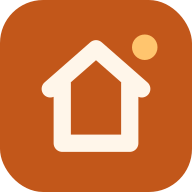

<h1 align="center">sPhone</h1>

<b>Votre téléphone, dans un coin de votre écran. À la souris et au clavier.</b>

  
  

Répondre à un message sans lâcher le clavier, retrouver une photo, lancer une appli du
téléphone pendant que vous travaillez : sPhone affiche l'écran de votre téléphone Android
dans une fenêtre de votre PC Windows, et vous le pilotez comme s'il était entre vos mains.
Par câble ou par Wi-Fi, sans rien installer sur le téléphone.

  
  
  

## Pourquoi sPhone

- **Plus besoin de prendre le téléphone.** Il reste posé sur le bureau ; tout se fait depuis
  le PC, avec un vrai clavier et une vraie souris.
- **Une fenêtre qui ne prend pas toute la place.** Elle a le format du téléphone et se range
  dans un coin de l'écran, à côté de votre travail.
- **Branchez, c'est affiché.** Le téléphone est reconnu dès qu'il est branché et son écran
  s'ouvre tout seul. Ensuite, un clic suffit pour passer au Wi-Fi.

## Ce que fait sPhone

### 🖱️ Le téléphone au bout de la souris
Un clic pour toucher l'écran, clic droit pour revenir en arrière, clic molette pour
l'accueil. La molette fait défiler, Ctrl + clic permet de zoomer.

### ⌨️ Le clavier du PC pour écrire
Tapez vos messages et vos recherches avec le clavier du PC ; en mode clavier physique, tous
les caractères et les raccourcis passent. Le copier-coller va du PC au téléphone et
inversement.

### 🔊 L'image et le son
L'écran en direct, fluide jusqu'à 120 images par seconde, et le son du téléphone dans les
haut-parleurs du PC.

### 📶 Par câble ou par Wi-Fi
Le câble USB pour la meilleure réactivité ; le Wi-Fi pour la liberté. sPhone retient vos
téléphones et s'y reconnecte au lancement. Même la première connexion peut se faire sans
câble, avec le débogage sans fil d'Android.

### 🪟 Une fenêtre à votre mesure
Quatre tailles, étirable à la souris sans déformer l'image, et toujours au premier plan si
vous le souhaitez.

### 📸 Captures et fichiers
Une capture d'écran du téléphone en un clic, rangée dans vos Images. Glissez un fichier
dans la fenêtre pour l'envoyer sur le téléphone, ou un APK pour l'installer.

### 🔋 Le téléphone au repos
Éteignez son écran pendant que vous vous en servez depuis le PC : il reste utilisable, et
sa batterie vous dit merci. Il peut aussi se mettre en veille tout seul quand vous fermez
la fenêtre.

### 🌗 Clair ou sombre
Un thème clair et un thème sombre, au choix ou selon Windows.

## Prise en main

1. **Installez** sPhone sur le PC avec le bouton en haut de cette page.
2. **Préparez** le téléphone une seule fois : activez le *débogage USB* dans ses options de
   développement (le mode d'emploi, dans l'appli, montre où le trouver).
3. **Branchez** le téléphone et acceptez l'autorisation qui s'affiche dessus : son écran
   apparaît sur le PC.

Le [guide d'utilisation](docs/GUIDE.md) détaille la première connexion, le Wi-Fi, tous les
raccourcis et les solutions aux soucis courants.

## Questions fréquentes

**Faut-il installer une appli sur le téléphone ?** Non. sPhone utilise la liaison de
débogage intégrée à Android ; rien ne reste sur le téléphone.

**Mes données passent-elles par Internet ?** Non. L'image et les commandes vont directement
du téléphone au PC, par le câble ou par votre Wi-Fi. Pas de compte, pas de serveur, pas de
publicité.

**Avec quels téléphones ?** Les téléphones Android 5.0 et plus récents, le son demandant
Android 11 ou plus. sPhone a été pensé autour d'un Samsung Galaxy S25.

**Est-ce rapide ?** sPhone s'appuie sur [scrcpy](https://github.com/Genymobile/scrcpy), la
référence en la matière : décodage vidéo matériel et réaction quasi immédiate, surtout en USB.

## La famille sPack

sPhone fait partie de **sPack**, une famille d'applications pratiques pour la maison, toutes
dans le même style.

| | | |
| :---: | :---: | :---: |
|  |  |  |
| **[sDash](https://github.com/ShinezeoGame/sDash)** Toute la maison sur une tablette | **sPhone** L'écran du téléphone sur le PC | **[sDrop](https://github.com/ShinezeoGame/sDrop)** Fichiers et textes entre téléphone et PC |

---

Fonctionnement, développement et logo : voir [docs/DEVELOPPEMENT.md](docs/DEVELOPPEMENT.md).
sPhone embarque [scrcpy](https://github.com/Genymobile/scrcpy) et adb, sous licence Apache 2.0.
Police [Outfit](https://github.com/Outfitio/Outfit-Fonts) sous licence SIL Open Font License 1.1.
