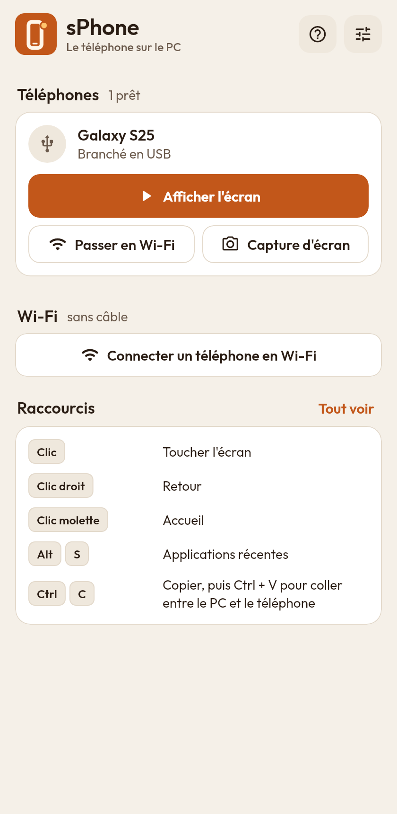
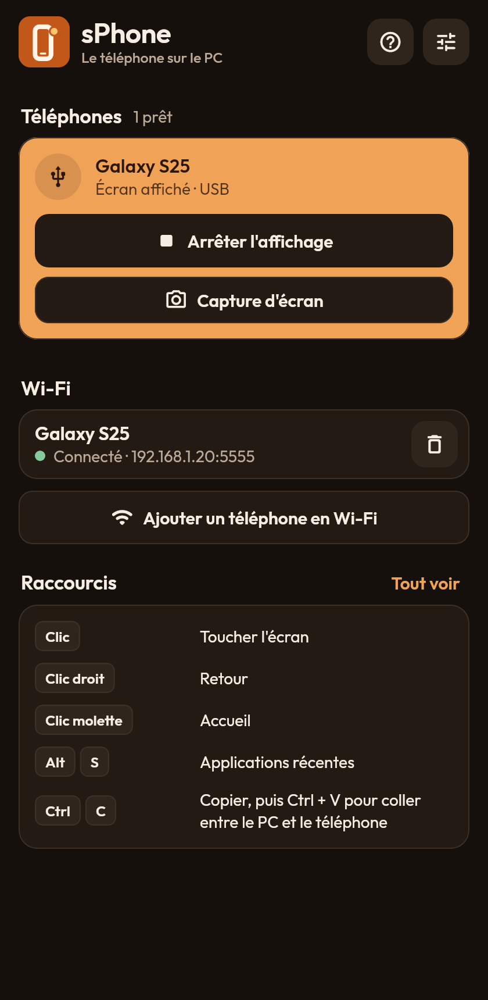
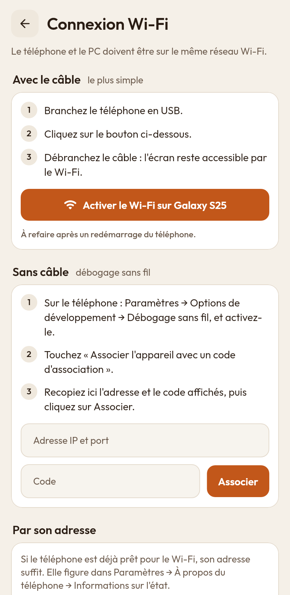

<p align="center"></p>

# sPhone

L'écran de votre téléphone Android dans une fenêtre de votre PC Windows, à contrôler au
clavier et à la souris. La fenêtre a le format du téléphone, pour tenir dans un coin de
l'écran. Le téléphone se relie par câble USB ou par Wi-Fi.

<p align="center">
  <a href="https://github.com/ShinezeoGame/sPhone/releases/latest/download/sphone-setup.exe"></a>
  <a href="https://github.com/ShinezeoGame/sPhone/releases/latest"></a>
</p>

<p align="center">
  
  
  
</p>

## Fonctionnalités

- **Affichage et contrôle** : l'écran du téléphone en direct, avec le son ; la souris
  touche l'écran, le clavier du PC écrit dans l'application ouverte, le copier-coller est
  partagé entre le PC et le téléphone.
- **Fenêtre au format du téléphone** : quatre tailles au choix, étirable à la souris en
  gardant ses proportions, option « toujours au premier plan ».
- **USB ou Wi-Fi** : branchez le câble et l'écran s'affiche ; un bouton fait passer le
  téléphone en Wi-Fi pour pouvoir le débrancher. La connexion sans aucun câble (débogage
  sans fil d'Android 11 et plus) est aussi prise en charge.
- **Rapide** : l'affichage repose sur [scrcpy](https://github.com/Genymobile/scrcpy), la
  référence du domaine (décodage vidéo matériel, latence de quelques dizaines de
  millisecondes). Trois niveaux de qualité, jusqu'à 120 images par seconde.
- **Capture d'écran** du téléphone, enregistrée dans `Images\sPhone`.
- **Confort** : éteindre l'écran du téléphone pendant qu'on s'en sert depuis le PC,
  l'empêcher de se mettre en veille, le verrouiller à la fermeture.
- **Thème clair ou sombre**, dans le même style que [sDash](https://github.com/ShinezeoGame/sDash).

Rien à installer sur le téléphone, aucun compte, aucune publicité : tout passe par la
liaison de débogage d'Android, entre votre téléphone et votre PC.

## Installation

1. Téléchargez **sphone-setup.exe** avec le bouton en haut de cette page et lancez-le.
   L'application n'est pas signée : si Windows affiche « Windows a protégé votre
   ordinateur », cliquez sur « Informations complémentaires » puis « Exécuter quand même ».
2. L'installation se fait dans votre profil, sans droits d'administrateur.

Une version portable (`sphone-windows.zip`, à décompresser) est proposée dans les
[versions](https://github.com/ShinezeoGame/sPhone/releases). Les compilations de chaque
branche sont aussi disponibles en artefact **sphone-windows** dans l'onglet **Actions**.

## Première connexion (une seule fois)

Sur un Samsung Galaxy — les intitulés varient peu sur les autres téléphones :

1. **Paramètres → À propos du téléphone → Informations sur le logiciel**, touchez sept fois
   « Numéro de version » : les options de développement apparaissent.
2. **Paramètres → Options de développement**, activez **Débogage USB**.
3. Branchez le téléphone au PC avec un câble USB qui transmet les données.
4. Sur le téléphone, cochez « Toujours autoriser sur cet ordinateur » puis **Autoriser**.

sPhone affiche alors le téléphone et ouvre son écran.

| Souci | Solution |
| --- | --- |
| « Débogage USB » est grisé | Désactivez **Paramètres → Sécurité et confidentialité → Blocage auto**. |
| Le téléphone n'apparaît pas | Essayez un autre câble ou une autre prise USB. Sinon, installez le pilote [Samsung USB Driver](https://developer.samsung.com/android-usb-driver). |
| L'image saccade en Wi-Fi | Choisissez la qualité « Fluide » dans les réglages. |

## Wi-Fi

Le téléphone et le PC doivent être sur le même réseau.

- **Avec le câble (le plus simple)** : téléphone branché, cliquez sur **Passer en Wi-Fi**,
  puis débranchez. sPhone mémorise l'adresse et s'y reconnecte au lancement. À refaire
  après un redémarrage du téléphone.
- **Sans câble** : dans **Options de développement → Débogage sans fil**, touchez
  « Associer l'appareil avec un code d'association » et recopiez l'adresse et le code dans
  sPhone (**Connecter un téléphone en Wi-Fi**).

## Raccourcis dans la fenêtre du téléphone

| Geste ou touches | Effet |
| --- | --- |
| Clic | Toucher l'écran |
| Clic droit | Retour |
| Clic molette | Accueil |
| Alt + S | Applications récentes |
| Ctrl + C, Ctrl + V | Copier-coller entre le PC et le téléphone |
| Alt + ↑ / Alt + ↓ | Volume |
| Alt + N | Notifications |
| Alt + P | Bouton marche / veille |
| Alt + O | Éteindre l'écran du téléphone (Alt + Maj + O pour le rallumer) |
| Alt + R | Pivoter l'écran |
| Alt + F | Plein écran |
| Ctrl + clic maintenu | Zoomer (pincer) |
| Glisser un fichier | L'envoyer sur le téléphone (un APK est installé) |

## Comment ça marche

sPhone est une application [Flutter](https://flutter.dev) pour Windows. Elle embarque
deux logiciels libres (licence Apache 2.0) placés dans son dossier `scrcpy` :

- **adb**, l'outil de liaison d'Android. sPhone dialogue directement avec son service
  local : la liste des téléphones arrive en continu, sans interrogation périodique.
- **scrcpy 5.0.1**, qui affiche l'écran et transmet clavier et souris. sPhone le lance
  avec les réglages choisis, sous son propre nom et sa propre icône.

À la fermeture de sPhone, la fenêtre du téléphone se ferme et le service adb s'arrête.

## Développement

Flutter 3.47 et, pour compiler, Visual Studio avec la charge « Développement Desktop en C++ ».

```powershell
.\tools\scrcpy.ps1                               # télécharge scrcpy + adb (empreinte vérifiée)
$env:SPHONE_SCRCPY_DIR = "$PWD\build\scrcpy"     # où l'application les trouve en développement
flutter run -d windows
```

- Vérifications : `flutter analyze` et `flutter test` (les tests fonctionnent sur tout
  système, sans téléphone : un faux service adb joue le rôle du vrai).
- La version de scrcpy, son adresse et son empreinte sont fixées dans `tools/scrcpy.json`.
- Logo : `tools/logo/generer_logo.py` produit les SVG de `docs/logo`, `tools/logo/exporter.py`
  les PNG et l'icône Windows (voir ci-dessous).
- `.github/workflows/build-windows.yml` compile, teste (y compris un lancement réel de
  l'application) et produit l'installateur à chaque envoi ; la version est publiée à
  chaque envoi sur `main`.

## Logo

sPhone partage sa marque avec [sDash](https://github.com/ShinezeoGame/sDash) : le même carré
orange, le même trait clair, et le même point ambre, toujours au même endroit. Seul le
dessin change — ici un téléphone, dont le point est la pastille de notification. Le « S »
seul est le signe de la marque.


