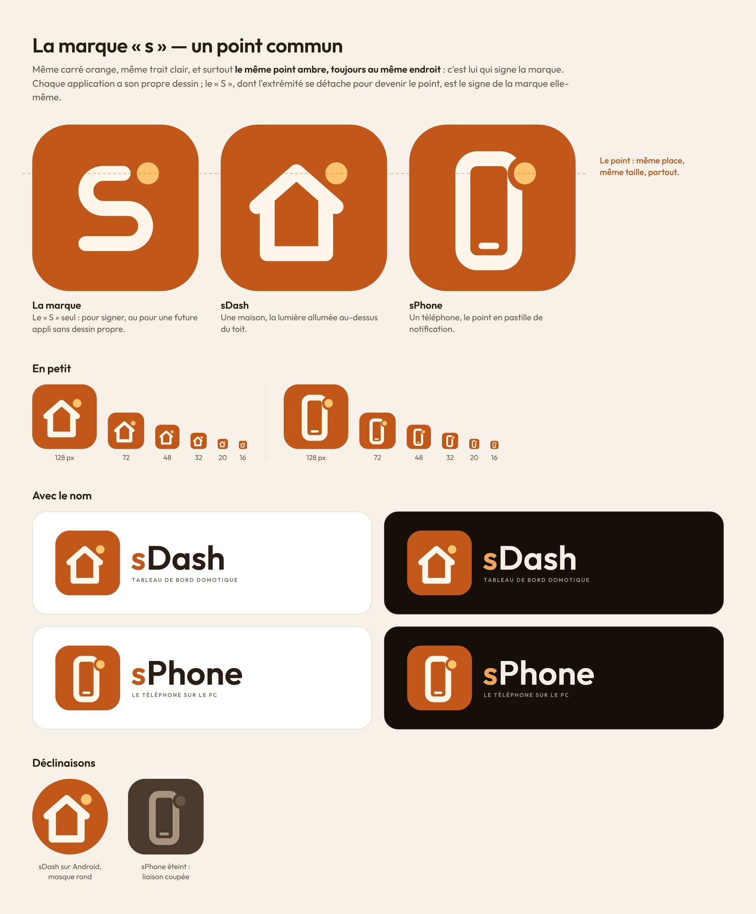

# Développement de sPhone

[← Retour à la présentation](../README.md)

## Comment ça marche

sPhone est une application [Flutter](https://flutter.dev) pour Windows. Elle embarque
deux logiciels libres (licence Apache 2.0) placés dans son dossier `scrcpy` :

- **adb**, l'outil de liaison d'Android. sPhone dialogue directement avec son service
  local : la liste des téléphones arrive en continu, sans interrogation périodique.
- **scrcpy 5.0.1**, qui affiche l'écran et transmet clavier et souris. sPhone le lance
  avec les réglages choisis, sous son propre nom et sa propre icône.

À la fermeture de sPhone, la fenêtre du téléphone se ferme et le service adb s'arrête.

## Compiler et lancer

Flutter 3.47 et, pour compiler, Visual Studio avec la charge « Développement Desktop en C++ ».

```powershell
.\tools\scrcpy.ps1                               # télécharge scrcpy + adb (empreinte vérifiée)
$env:SPHONE_SCRCPY_DIR = "$PWD\build\scrcpy"     # où l'application les trouve en développement
flutter run -d windows
```

- Vérifications : `flutter analyze` et `flutter test` (les tests fonctionnent sur tout
  système, sans téléphone : un faux service adb joue le rôle du vrai).
- La version de scrcpy, son adresse et son empreinte sont fixées dans `tools/scrcpy.json`.
- `.github/workflows/build-windows.yml` compile, teste (y compris un lancement réel de
  l'application) et produit l'installateur à chaque envoi ; la version est publiée à
  chaque envoi sur `main`.

## Logo

sPhone fait partie de la marque **sPack**, avec [sDash](https://github.com/ShinezeoGame/sDash)
et [sDrop](https://github.com/ShinezeoGame/sDrop) : même carré orange, même trait clair, un
dessin centré propre à chaque application (ici un téléphone), et le même point ambre posé
dans l'angle en haut à droite.



`tools/logo/generer_logo.py` produit les SVG de `docs/logo`, `tools/logo/exporter.py` les PNG
et l'icône Windows.

## Licences

scrcpy et adb sous licence Apache 2.0. Police [Outfit](https://github.com/Outfitio/Outfit-Fonts)
sous licence SIL Open Font License 1.1.
